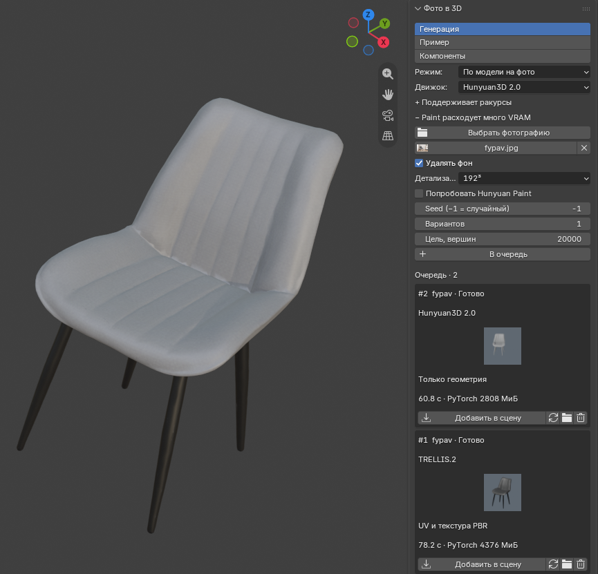

# Photo to 3D for Blender

Generate textured 3D assets from reference photos with TRELLIS.2 and Hunyuan3D, then import or export them from Blender.

*This project is pure vibe coding.*

[Project website](https://rorosos.github.io/photo-to-3d-blender/) · [Download v1.7.1 for Windows](./photo-to-3d-windows.zip) · [Component terms](./THIRD_PARTY_NOTICES.md)

## What it does

- Generate from one JPG or PNG, or use front, left, and back references with Hunyuan3D.
- Add JPG or PNG files by dragging them from File Explorer onto **Choose photo** or a photo preview in the Blender sidebar.
- Paste a copied image or screenshot from the Windows clipboard, including into an individual multi-view slot.
- Queue jobs and seed variants, see progress, and import finished models into a scene.
- Export FBX, preview images, and available textures to each job folder.
- Install the model, its engine, and required libraries with one click in Blender's sidebar.

## Install

1. Use Blender 5.3 or later on Windows x64 with a compatible NVIDIA CUDA GPU and driver.
2. In Blender, choose **Edit → Preferences → Add-ons → Install from Disk** and select `photo-to-3d-windows.zip`.
3. In the 3D Viewport, press **N** and open **Photo to 3D**. Set your language and engine.
4. Click **Download model and engine**. Use **Components** to add another model or the optional Hunyuan Paint package later.
5. In **Generate → Single photo**, use **Choose photo**, drag files into the panel, or click **Paste from clipboard**. Click **Add to queue**. When generation finishes, use **Import into scene** or open the job folder from the queue.

Enable online access in **Preferences → System → Network** for downloads. The compact ZIP includes the TRELLIS.2 example and Python source. Blender downloads the public component files directly, without an account, access request, or token. TRELLIS.2 uses the original DINOv3 ViT-L/16 and BiRefNet HR-matting for optional background removal. Generation runs locally after installation.

Interface languages include English, Russian, Simplified Chinese, Hindi, Spanish, Arabic, French, Bengali, Portuguese, Indonesian, Urdu, and German.

## Maintainer

[Rorosos](https://github.com/Rorosos). See [third-party notices](./THIRD_PARTY_NOTICES.md) for model terms and demo attribution.
